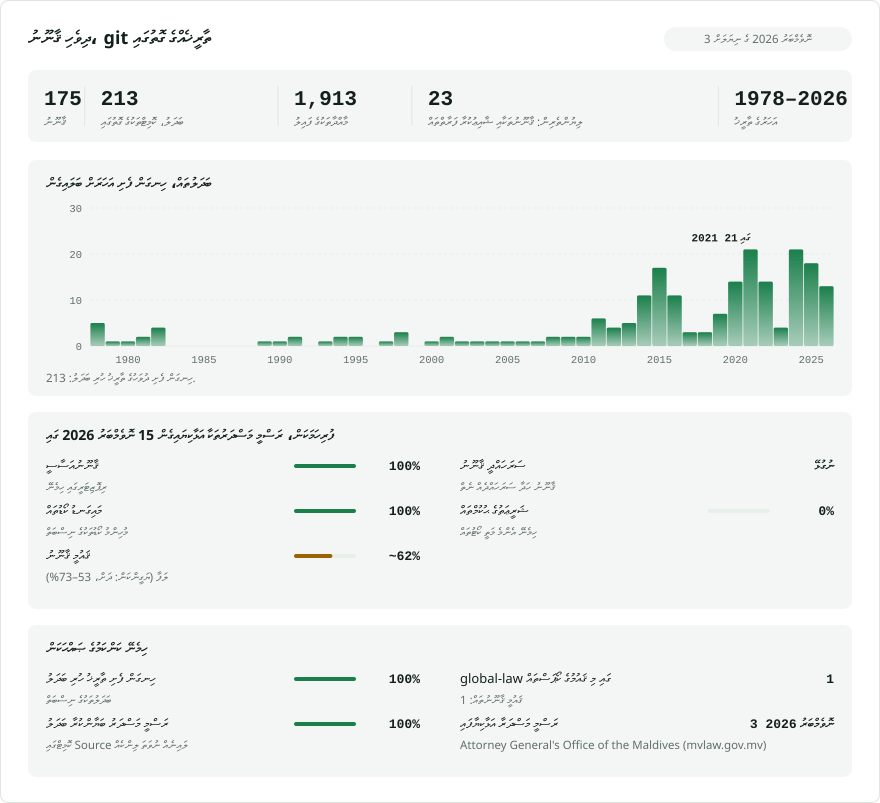

# ދިވެހިރާއްޖެ: git ގައި ޤާނޫނުތަކުގެ ތާރީޚު

**ދިވެހި** · [English](README.en.md)

<picture>
<source media="(prefers-color-scheme: dark)" srcset="data/dv/effort-dark.svg">

</picture>

ދިވެހިރާއްޖޭގެ ޤާނޫނުތައް git ތާރީޚެއްގެ ގޮތުގައި: ޤާނޫނުއަސާސީއާއި މައިގަނޑު ހަތަރު ޤާނޫނުގެ ކޮންމެ މާއްދާއަކަށް އެއް ފައިލް، އަދި އެހެން ޤާނޫނުތަކުގެ ކޮންމެ ޤާނޫނަކަށް އެއް ފައިލް؛ ކޮންމެ ނުސްޚާއަކަށް (ނުވަތަ އެއް ނުސްޚާއެއް ގެނައީ އެތައް ޤާނޫނަކުން ނަމަ، އިޞްލާޙު ގެނައި ކޮންމެ ޤާނޫނަކަށް) އެ ނުސްޚާ ހިނގަން ފެށި ދުވަހު އެއް ކޮމިޓް؛ އަދި ކޮމިޓުގެ ލިޔުންތެރިޔާ (author) އަކީ އެ ބަދަލު ގެނައި ޤާނޫނެވެ. `git blame` އިން ކޮންމެ ސަތުރެއްގެ ފަހަތުގައިވާ ޤާނޫނު ދައްކައެވެ. `git log` އިން މާއްދާއަކަށް ގެނެވުނު ހުރިހާ ބަދަލެއް ލިސްޓުކޮށްދެއެވެ. ތާރީޚެއް ހޮވައިފިނަމަ، އެ ދުވަހު ހިނގަމުންދިޔަ ލިޔުން ލިބެއެވެ.

މިއީ [lexifina/global-law](https://github.com/lexifina/global-law) ގެ ބައެކެވެ. އެއީ ހުރިހާ ޤައުމެއްގެ ޤާނޫނުތައް ހިމެނޭ އެއް git ތާރީޚެކެވެ. މިއީ ދިވެހިރާއްޖޭގެ ޤައުމީ ޤާނޫނުތަކެވެ. global-law މިތަކެތި ކިޔަނީ `maldives/national/acts/` އިންނެވެ.

**މިހާރު މިއޮތީ:** އެޓަރނީ ޖެނެރަލްގެ އޮފީހުން ޝާއިޢުކުރާ ޤާނޫނުއަސާސީއާއި 174 ޤާނޫނު، 1978 އިން 2026 އަށް ހިނގި 205 ނުސްޚާއާއެކުގައެވެ. ޤާނޫނުއަސާސީ (2008 އިން ފެށިގެން 9 ނުސްޚާ)، ޖިނާއީ ޤާނޫނު (7)، ޢަޤްދުތަކާބެހޭ ޤާނޫނު، ކުންފުނިތަކާބެހޭ ޤާނޫނު (2) އަދި ޢާއިލާ ޤާނޫނު (3) ބަހައްޓާފައިވަނީ މާއްދާ މާއްދާއިން، އެ ޤާނޫނުތަކަށް ގެނެވުނު އިޞްލާޙުތަކާއެކުގައެވެ. ބާކީ 170 ޤާނޫނުގެ ކޮންމެ ޤާނޫނެއް ހުރީ އެއް ފައިލެއްގައެވެ. އޭގެތެރެއިން 3 ޤާނޫނުގެ ކުރީގެ ނުސްޚާތައްވެސް ހިމެނެއެވެ. [`REPRODUCE.md`](REPRODUCE.md) ގައި ކޮންމެ ޤާނޫނެއް އޭގެ ނުސްޚާތަކާއެކު ލިސްޓުކޮށްފައިވާއިރު، [`data/versions.json`](data/versions.json) ގައި ކޮންމެ ނުސްޚާއެއް ނެގި ޞަފްޙާ ދީފައިވެއެވެ.

ޤާނޫނުއަސާސީއާއި އެ ހަތަރު ޤާނޫނު ހުރީ ނަން ދީފައިވާ ފޯލްޑަރުތަކުގައި، ކޮންމެ މާއްދާއަކަށް އެއް ފައިލްގެ ގޮތުގައެވެ (`constitution/art-109.md` އަކީ ޤާނޫނުއަސާސީގެ 109 ވަނަ މާއްދާ، ރައީސުލްޖުމްހޫރިއްޔާގެ މަޤާމަށް އިންތިޚާބުވެވޭނީ ކާކުކަން). އެހެން ޤާނޫނުތައް ހުރީ `law-<id>/text.md` ގައި، mvlaw.gov.mv ގައި އެ ޤާނޫނަށް ދީފައިވާ ނަންބަރުންނެވެ (`law-109/text.md` އަކީ ވަޒީފާއާބެހޭ ޤާނޫނު، ޤާނޫނު ނަންބަރު 2/2008). ކޮންމެ ފޯލްޑަރެއްގެ `README.md` ގައި އޭގެ މާއްދާތައް ލިސްޓުކޮށްފައިވެއެވެ.

ލިޔުން ހުރީ ދިވެހިބަހުން، ތާނަ އަކުރުން، mvlaw.gov.mv ގައި ޝާއިޢުކޮށްފައިވާ ގޮތަށެވެ. އިނގިރޭސި ތަރުޖަމާއެއް މި ރިކޯޑުގައި ނުހިމެނެއެވެ.

## git ކޮމާންޑުތަކުގެ ގޮތުގައި ސުވާލުތައް

| ސުވާލު | ކޮމާންޑު |
| --- | --- |
| ޤާނޫނުއަސާސީގެ 109 ވަނަ މާއްދާއަށް ގެނެވުނު ހުރިހާ ބަދަލެއް | `git log -p --word-diff -- constitution/art-109.md` |
| 109 ވަނަ މާއްދާގެ ކޮންމެ ސަތުރެއް ލިޔުނީ ކޮން ޤާނޫނަކުން؟ | `git blame constitution/art-109.md` |
| ޤާނޫނުއަސާސީގެ ހުރިހާ ނުސްޚާއެއް، ކޮންމެ ނުސްޚާއެއް ހިނގަން ފެށި ދުވަހާއެކު | `git log --format="%h %(trailers:key=In-force,valueonly,separator=) %an" -- constitution ":!constitution/README.md"` |
| 1 ޖަނަވަރީ 2016 ގައި ހިނގަމުންދިޔަ ގޮތަށް 109 ވަނަ މާއްދާ | `python tools/on.py 2016-01-01 constitution art-109` |

**git އިން ބޭރުގައިވެސް** މި ރިކޯޑު އަހަރެމެން ހިލޭ، ހުޅުވާލާފައިވާ ގޮތަށް ހޮސްޓްކުރަމެވެ:

- **[ދިވެހި ޤާނޫނާބެހޭގޮތުން Claude އާ ސުވާލުކުރައްވާ](https://global-law.lexifina.com/v1/try_claude?country=maldives)**: ފުރަތަމަ ސުވާލެއް ތައްޔާރުކޮށްގެން Claude ހުޅުވައިދެއެވެ.
- **[ChatGPT އާ ސުވާލުކުރައްވާ](https://global-law.lexifina.com/v1/try_chatgpt?country=maldives)**: އެ ސުވާލު ChatGPT ގައި.
- **[އަހަރެމެންގެ ސައިޓުގައި ދިވެހި ޤާނޫނުތަކުން ހޯއްދަވާ](https://lexifina.com/law?country=maldives&q=%DE%87%DE%A6%DE%80%DE%A6%DE%83%DE%A9+%DE%97%DE%AA%DE%87%DE%B0%DE%93%DE%A9)**: "އަހަރީ ޗުއްޓީ" ހޯދުމުގެ ނަތީޖާ، ކޮންމެ މާއްދާއެއްގެ ލިޔުމާއި އޭގެ ނުސްޚާތަކާއެކު، އެކައުންޓެއް ނުހަދައި.
- **[ޑިވެލޮޕަރުންނަށް REST API](https://global-law.lexifina.com/v1/search_law?query=%DE%87%DE%A6%DE%80%DE%A6%DE%83%DE%A9+%DE%97%DE%AA%DE%87%DE%B0%DE%93%DE%A9&jurisdiction=maldives)**: އެ ހޯދުން JSON ގެ ގޮތުގައި، ކީއެއް ނެތި. [ޑޮކިއުމެންޓޭޝަން މިތަނުގައި](https://lexifina.com/api/global-law).

ދެ އެސިސްޓެންޓުވެސް މި ރިކޯޑު ކިޔަނީ ހިލޭ Global law ކަނެކްޓަރ (MCP، `https://global-law.lexifina.com/mcp`) މެދުވެރިކޮށެވެ. ފުރަތަމަ ފަހަރު، އެ ކަނެކްޓަރ އިތުރުކުރާ ލިންކް ޗެޓުން ދެއްވާނެއެވެ. ސުވާލުކުރެވޭނީ ދިވެހިބަހުން ނުވަތަ އިނގިރޭސިބަހުންނެވެ.

**ފަސޭހައިން އަމިއްލައަށް ހޮސްޓްކުރެވޭނެއެވެ.** ބޭނުންވަނީ git އާއި Python އެކަންޏެވެ. ޓޫލްތައް ހިނގަނީ ތިބާގެ ކޮމްޕިއުޓަރުގައެވެ:

```sh
git clone --depth 1 https://github.com/lexifina/global-law && cd global-law
python3 tools/countries.py add maldives/national/acts
python3 tools/law.py show 2026-01-01 maldives/national/acts/constitution/art-109.md
```

Claude Code، Cursor، VS Code ނުވަތަ Codex ގައި ހުޅުވައިފިނަމަ، މި ކްލޯނުން އެ ޓޫލްތަކާއެކު ލޯކަލް MCP ސާވަރެއްވެސް ފަށައިދެއެވެ ([MCP.md](https://github.com/lexifina/global-law/blob/main/MCP.md)).

## ތާރީޚުތައް

ކޮންމެ ކޮމިޓެއްގެ ތާރީޚަކީ އެ ނުސްޚާ ހިނގަން ފެށި ދުވަހުގެ މެންދުރު (Indian/Maldives) އެވެ. އެ ދުވަސް އޭގެ `In-force:` ޓްރެއިލަރުގައި ހިމެނެއެވެ:

- ކޮންމެ ނުސްޚާއަކަށް، އެ ނުސްޚާއަށް mvlaw.gov.mv ދޭ ތަންފީޒުކުރާ ތާރީޚު. ޤާނޫނުއަސާސީގެ ފުރަތަމަ ނުސްޚާގެ ތާރީޚަކީ އެ ތަޞްދީޤުކުރި ދުވަސް، 7 އޯގަސްޓު 2008؛
- ކޮންމެ ޤާނޫނެއް އެއް ފައިލެއްގައި ބަހައްޓާފައިވާ 170 ޤާނޫނަށް، ތާރީޚު ފެށެނީ ސައިޓުގައި ލިޔުމެއްގެ ގޮތުގައި ޝާއިޢުކޮށްފައިވާ އެންމެ ކުރީގެ ނުސްޚާއިންނެވެ. އެހެންކަމުން ފުރަތަމަ ތާރީޚަކީ ޤާނޫނު ފާސްކުރިތާ އެތައް އަހަރެއް ފަހުގެ ތާރީޚަކަށް ވެދާނެއެވެ (ވަޒީފާއާބެހޭ ޤާނޫނު ފެށެނީ 2026-03-08 ގައި)؛
- އިޞްލާޙު ގެނައި ޤާނޫނުތައް ފާސްކުރި ތާރީޚު ސައިޓުގައި ނެތުމުން، އެފަދަ ތާރީޚެއް ރިކޯޑުކޮށްފައެއް ނުވެއެވެ.

މާއްދާ މާއްދާއިން ބަހައްޓާފައިވާ ކޮންމެ ޤާނޫނެއްގެ ފުރަތަމަ ލިޔުން ނިސްބަތްކޮށްފައިވަނީ އެ ޤާނޫނަށެވެ. ފަހުން ގެނެވުނު ކޮންމެ ބަދަލެއް ނިސްބަތްކޮށްފައިވަނީ، ބަދަލުވި މާއްދާއަށް ސައިޓުގެ އިޞްލާޙީ ނޯޓުތަކުގައި ނަން ދީފައިވާ ޤާނޫނަށެވެ (ޖުމްލަ 23 ކޮމިޓް). ބާކީ 170 ޤާނޫނުގެ ލިބެން ހުރި އެންމެ ކުރީގެ ނުސްޚާއާއި، އެއްވެސް ނޯޓަކުން ސަބަބު ބަޔާންނުކުރާ 20 ބަދަލު ނިސްބަތްކޮށްފައިވަނީ ޝާއިޢުކުރާ ފަރާތް، ދިވެހިރާއްޖޭގެ އެޓަރނީ ޖެނެރަލްގެ އޮފީހަށެވެ.

## ޗެކުކުރާ ގޮތް

- `tools/check_repo.py` އިން ކޮންމެ ނުސްޚާއެއް، އެ ހިނގަން ފެށި ދުވަހާއި އޭގެ ކުރީ ދުވަހު git އިން އަނބުރާ ކިޔައި، އެ ބިނާކުރި ކޯޕަހާ ފައިލް ފައިލުން އަޅާކިޔައި، ކޮންމެ ކޮމިޓެއްގެ ޓްރެއިލަރުތައް ޕާސްވާކަން ޗެކުކުރެއެވެ. މި ބިލްޑަށް އެ ހިންގިކަމެއް `REPRODUCE.md` ގައި އަދި ރިކޯޑުކޮށްފައެއް ނުވެއެވެ.
- އެ ކޯޕަހުން ހުސް ފޯލްޑަރަކަށް ދެވަނަ ފަހަރަށް ބިލްޑުކުރިއިރު، ތާރީޚުގެ ހުރިހާ 213 ކޮމިޓާއި 227 ޓެގަށް އެއްފަދަ ހޭޝްތައް ލިބުނެވެ. ކޯޕަހުގެ ހޭޝް [`data/corpus.sha256`](data/corpus.sha256) ގައި، އަދި ތަފްޞީލު [`REPRODUCE.md`](REPRODUCE.md) ގައި ވެއެވެ.
- ތާރީޚަށް ކުރެވެނީ އިތުރުކުރުން އެކަންޏެވެ: އާ ނުސްޚާތައް އިތުރުކުރެވެނީ ޝާއިޢުކުރެވިފައިވާ އެންމެ ފަހު ކޮމިޓުގެ ފަހަތުންނެވެ. އެއްވެސް ކޮމިޓެއް އަލުން ލިޔެވިފައެއް ނުވެއެވެ. `main` ގައި މާޖް ކޮމިޓެއް ނުވަތަ މުސްތަޤްބަލުގެ ތާރީޚެއް ޖަހާފައިވާ ކޮމިޓެއް ނެތެވެ.
- [vulnerabilities/](vulnerabilities/): global-law ގެ ކުށްތައް ހޯދާ ޓޫލްތަކުން ދިވެހި ޤާނޫނުތަކުން ހޯދައި، އަތުން ޗެކުކުރި، ލިޔުމުގައި ހުރެދާނެ ކުށްތައް.

## ނުދައްކާ ކަންތައްތައް

- **ގިނަ ޤާނޫނުތަކުގެ ކުރީގެ ނުސްޚާތައް.** އެއް ފައިލެއްގައި ބަހައްޓާފައިވާ 170 ޤާނޫނުގެ ތެރެއިން 167 ޤާނޫނަށް ހުރީ ސައިޓުގައި ލިޔުމެއްގެ ގޮތުގައި ޝާއިޢުކޮށްފައިވާ އެއް ނުސްޚާ އެކަންޏެވެ. އެ ޤާނޫނުތަކުގެ ކުރީގެ ނުސްޚާތަކާއި، ގިނަ ޤާނޫނުތަކުގެ ފުރަތަމަ ފާސްކުރި ނުސްޚާ މިތާ ނެތެވެ.
- **ގަވާއިދުތަކާއި، ކޯޓުތަކުގެ ޙުކުމްތަކާއި، މުޢާހަދާތަކާއި، ބިލުތައް.** މިތާ ހިމެނޭނީ ޤާނޫނުއަސާސީއާއި ޤާނޫނުތައް އެކަންޏެވެ. ސައިޓުގައި ސާބިތުނުކުރެވޭ ލިޔެކިޔުމެއް ނުވަތަ މީޑިއާއެއް އެތެރެކޮށްފައިވާ، ނުވަތަ ފުރިހަމަނުވާ ނުސްޚާތަކެއް ހުރި ޤާނޫނުތައް މުޅިން ދޫކޮށްލާފައިވެއެވެ.
- **ލިޔުމެއް ނެތް ޖަދުވަލުތަކާއި ސުރުޚީތައް.** ޤާނޫނުއަސާސީގެ ތިން ޖަދުވަލާއި، މާއްދާ މާއްދާއިން ބަހައްޓާފައިވާ ހަތަރު ޤާނޫނުގެ ބައިތަކުގެ ސުރުޚީތަކުގައި ސައިޓުގައި އެއްވެސް ލިޔުމެއް ނެތުމުން، އެތަކެތި ހިމަނާފައެއް ނުވެއެވެ.
- **އިޞްލާޙީ ނޯޓުތަކާއި އުވާލެވުނު މާއްދާތައް.** ސައިޓުގެ އިޞްލާޙީ ނޯޓުތައް ލިޔުމުގެ ބައެއް ނޫނެވެ. އަދި ސައިޓުން އުވާލެވިފައިވާކަމަށް ފާހަގަކުރާ މާއްދާތައް، އެ އުވާލާ ނުސްޚާއިން ފެށިގެން ދޫކޮށްލާފައިވެއެވެ.

## މަސްދަރުތައް

| މަސްދަރު | ބާވަތް | ކުރީގެ ނުސްޚާތައް | ނޯޓު |
| --- | --- | --- | --- |
| [Maldives Laws](https://mvlaw.gov.mv) (އެޓަރނީ ޖެނެރަލްގެ އޮފީސް) | ޤާނޫނުތައް ޝާއިޢުކުރާ ރަސްމީ ވެބްސައިޓް | ލިޔުމެއްގެ ގޮތުގައި ޝާއިޢުކުރާ ނުސްޚާތައް، ކޮންމެ ނުސްޚާއެއް އޭގެ ތަންފީޒުކުރާ ތާރީޚާއެކު | ދިވެހި ލިޔުން؛ އޭގެ އިޞްލާޙީ ނޯޓުތަކުގައި އިޞްލާޙު ގެނައި ޤާނޫނުތަކުގެ ނަން ދީފައިވެއެވެ |

## ލައިސަންސް

[`LICENSE`](LICENSE) ބައްލަވާ. ދިވެހިރާއްޖޭގެ ޤާނޫނުތައް mvlaw.gov.mv ގައި ޝާއިޢުކޮށްފައިވަނީ ޢާންމުންގެ ބޭނުމަށެވެ. މި ރިޕޮޒިޓަރީއިން އެ ޤާނޫނުތަކުގެ މައްޗަށް އެއްވެސް ޙައްޤެއް ދަޢުވާއެއް ނުކުރެއެވެ. Lexifina އިން ކޮށްފައިވަނީ ސައިޓުގެ ޞަފްޙާތައް Markdown އަށް ބަދަލުކޮށް، HTML ނަގާލައި، ހުސްޖާގަ (whitespace) އެއްގޮތްކުރުމެވެ. އެނޫން ގޮތަކުން ލަފްޒުތަކަކީ ސައިޓުގައިވާ ލަފްޒުތަކެވެ.

އެއްވެސް AI މޮޑެލަކުން ޤާނޫނީ ލިޔުމެއް ލިޔެފައި، ތަރުޖަމާކޮށްފައި ނުވަތަ ރަނގަޅުކޮށްފައެއް ނުވެއެވެ. އަދި ތާރީޚު ބިނާކުރާއިރު އެއްވެސް މޮޑެލެއް ނުހިންގައެވެ. ސްކްރިޕްޓްތައް ލިޔުނީ AI މޮޑެލްތަކުންނެވެ (Claude އާއި GPT-6، [`REPRODUCE.md`](REPRODUCE.md) ބައްލަވާ).

މި ލިޔުމަކީ އިނގިރޭސި ނުސްޚާގެ ([README.en.md](README.en.md)) ތަރުޖަމާއެކެވެ. ތަފާތެއް ވާނަމަ، އިނގިރޭސި ނުސްޚާގައިވާ ގޮތަށް ޢަމަލުކުރެވޭނެއެވެ.

## އިތުރު މަޢުލޫމާތު

[lexifina/global-law](https://github.com/lexifina/global-law) ރިޕޮޒިޓަރީން (އިނގިރޭސި ބަހުން ލިޔެފައިވާ ޞަފްޙާތައް):

- [FEATURES.md](https://github.com/lexifina/global-law/blob/main/FEATURES.md): ހުރިހާ ފީޗަރެއް، އަދި ކޮންމެ ކޯޕަހެއް ސަޕޯޓްކުރަން ޖެހޭ ކަންތައް (`git blame`، `law.py`، MCP ޓޫލްތައް)
- [FAQ.md](https://github.com/lexifina/global-law/blob/main/FAQ.md): ސުވާލާއި ޖަވާބު · [CONTRIBUTING.md](https://github.com/lexifina/global-law/blob/main/CONTRIBUTING.md): ބަދަލު ހުށަހެޅުން · [MCP.md](https://github.com/lexifina/global-law/blob/main/MCP.md): MCP ސާވަރ · [REPRODUCE.md](https://github.com/lexifina/global-law/blob/main/REPRODUCE.md): ތައްޔާރުކުރި ގޮތް · [CHANGELOG.md](https://github.com/lexifina/global-law/blob/main/CHANGELOG.md)
- [FRESHNESS.md](https://github.com/lexifina/global-law/blob/main/FRESHNESS.md): ކޮންމެ ކޯޕަހެއް އަޕްޑޭޓްކޮށްފައިވާ މިންވަރު · [މޮނިޓަރިންގ](https://github.com/lexifina/global-law/tree/main/monitoring): އަޕްޑޭޓްތައް ހިނގަމުންދޭތޯ · [WATCHING.md](https://github.com/lexifina/global-law/blob/main/WATCHING.md): ބަދަލުތަކަށް ކޮންމެ ރަސްމީ މަސްދަރެއް ފާރަވެރިކުރާ ގޮތް
- [performance/](https://github.com/lexifina/global-law/tree/main/performance): ޓޫލްތަކުގެ ހަލުވިކަން، މިނިފައި
- [visualisations/](https://github.com/lexifina/global-law/tree/main/visualisations): ދުނިޔޭގެ ޤާނޫނުތައް ގުޅުވާ ޗާޓުތަކާއި ގުޅުންތައް
- [ކުށްތައް](https://github.com/lexifina/global-law/tree/main/vulnerabilities): ޝާއިޢުކުރެވުނު ގޮތަށް ޤާނޫނުތަކުގައިވާ ގޯސްތައް
