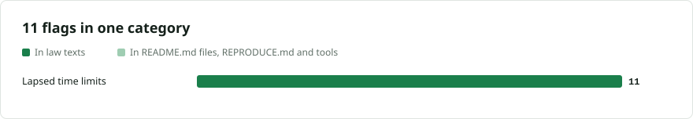

# Vulnerabilities in Maldivian law

[ދިވެހި](README.md) · **English**

<picture>
<source media="(prefers-color-scheme: dark)" srcset="img/flags-by-category-dark.svg">

</picture>

The vulnerability detectors from [lexifina/global-law](https://github.com/lexifina/global-law/tree/main/vulnerabilities) look for mechanical mistakes in legislation: a rule applying "until" a date that has passed, a time limit extended only after it had run out, two amendments to the same provision on the same day, a reference to an article that no longer exists. global-law's published list (9 November 2026) had no flags for the Maldives, so this is a run over this repository only, as it stood at commit [`dfcd21b`](https://github.com/lexifina/maldives-law/commit/dfcd21bc841a6662bfc671a12f700d79339d9fb0) on 16 November 2026: the Constitution and 174 statutes in Dhivehi, as the Attorney General's Office publishes them on mvlaw.gov.mv. The detectors did not read Dhivehi dates until they were fixed for this run (below).

**In short:** the detectors raised 11 flags, all lapsed time limits, in six statutes. A language model reviewed all 11, arguing each one for and against; 2 survived. Checked by hand in this repository, neither is a mistake in Maldivian law: both are in Law No. 29/2016 on the taxes and fees collected from passengers leaving the Maldives by air, whose airport service charge is levied only "until 31 December 2021" (Article 2(c)) and is followed from 1 January 2022 by the departure tax of Article 2-1, and whose airport development fee has a first period ending on 31 December 2021 (Article 3(a)(1)) followed by two more. They were flagged because this repository holds the Act in one version only, the oldest the site publishes as text, dated 5 November 2024. The other 9 flags are dates that close one band of a rate table whose next band follows, transitional rules that have run their course, and dates that fix a period or a population count rather than end a rule. Reading the flagged texts and the history of the Penal Code turned up two problems in this repository, listed below. Later, this will be formalised in Lean, similar to our work on [the US tax code](https://lexifina.com/blog/formalizing-the-us-tax-code) and [US case law](https://lexifina.com/blog/formalizing-all-us-case-law-in-lean).

A flag is a prompt to look, not legal advice, and nothing here has been tested in court.

## Flags by category

| Category | What it looks for | Flags | In law texts | Reviewed | Survived review |
| --- | --- | ---: | ---: | ---: | ---: |
| Lapsed time limits | Text still applying a rule "until" a date that has passed | 11 | 11 | 11 | 2 |

"In law texts" counts all the law this repository holds: the Constitution, the Penal Code, the Contract Act, the Companies Act and the Family Act (one file per article) and the other 170 statutes (`law-<id>/text.md`). The other files are the READMEs, the root files (the licence, `REPRODUCE.md`, `jurisdiction.json`), `data/` and `tools/`; none has a flag. The history detectors have little to read: 167 of the 170 statutes kept one file each have a single version, the oldest the site publishes as text, credited to the publisher, so their text never changes in the history. Only the five article-by-article acts are held with changes credited to the laws that made them (23 commits, among them each act's first text); the other 20 changes in the history, in three statutes, the Penal Code, the Companies Act and the Family Act, are ones no amendment note explains. The search for repeal gaps, same-day conflicts, retroactive dates, empty periods, stale amounts and references to deleted provisions found nothing. The time-limit search reads a day, a Dhivehi month and a year followed by "until" ("31 ޑިސެންބަރު 2021 ގެ ނިޔަލަށް"): in the law texts it finds all 11 such phrases, every one with a past date, and leaves out 3 that give only a year (2027 and 2030, not yet passed). The reference scan does not read Dhivehi references ("މި ޤާނޫނުގެ 25 ވަނަ މާއްދާ"); read by hand, none of the 569 references of the five article-by-article acts to their own articles points to an article this repository no longer holds.

*Edge cases: the 2 flags that survived the review, checked by hand, the 9 others, and an empty period the detectors could not see, in [EDGE-CASES.en.md](EDGE-CASES.en.md).*

## Problems found in this repository

- **A rate table missing from Law No. 29/2016:** in [`law-131/text.md`](https://github.com/lexifina/maldives-law/blob/dfcd21bc841a6662bfc671a12f700d79339d9fb0/law-131/text.md), Article 3(a) gives the airport development fee in three periods, each ending in a colon before a table of rates; the first period, "1 May 2017 to 31 December 2021", is followed directly by the second, with no table, so the text here does not say what the fee was in those years. Every other period in Articles 2-1 and 3 has its table. Not compared with mvlaw.gov.mv.
- **The Penal Code's commencement article in 2015:** the version of [Article 10 (unnumbered item 1)](https://github.com/lexifina/maldives-law/blob/dfcd21bc841a6662bfc671a12f700d79339d9fb0/penal-code/art-0010-x01.md) dated 5 May 2015 and credited to Law No. 6/2015 already holds the text that refers to Law No. 6/2015 as passed and sets out which law applied from 13 April to 16 July 2015; the unexplained version of 16 July 2015 drops that text, and the version of 3 September 2015, credited to Law No. 12/2015, brings it back. Law No. 12/2015 is also credited with a change on 5 May 2015 (Article 521, unnumbered item 3). The dates are the site's implementation dates for each consolidation; the record does not show when Law No. 12/2015 was passed.

## Files

| File | What it holds |
| --- | --- |
| [data/flags.csv](data/flags.csv) | Every flag, one row per provision and issue |
| [data/reviewed.csv](data/reviewed.csv) | The 11 flags the model reviewed, with its verdict and reason |
| [data/by_category.csv](data/by_category.csv) | The counts in the table above |
| [tools/](tools/) | The scripts that made this run |

Columns: `category` and `category_dv` (the category in English and Dhivehi), `detector`, `kind` (`law` or `other`), `path` (the file in this repository), `date` (the date the flag turns on), `reference` (the act or line involved; here the publisher the version is credited to), `summary`, `score` (the detector's ranking, 0 to 1), `review` (`artefact`, `lawful` or `candidate_defect`), `survives_rebuttal`, `review_note` (the model's reason, in English), `url` (the file at the commit that was read).

## How it was made

- **Detectors:** global-law's [vulnerabilities/scripts](https://github.com/lexifina/global-law/tree/main/vulnerabilities/scripts), with the fixes in [tools/](tools/README.md) (among them `patch_dv.py`, which teaches the time-limit and amount scans Dhivehi dates and amounts), run on this repository at commit `dfcd21b`. The history table the detectors read was built from this repository's own commits (the law or publisher each version is credited to, and the `In-force` and `Kind` trailers): the 23 commits of kind `law` and the 190 of kind `publisher` count as changes to the law. The corpus language was set to Dhivehi.
- **Model review:** gpt-5.4-mini, the 40 strongest flags per category, which here meant all 11; one pass says whether a flag is real, a second argues that it is not. There were no empty periods to review.
- **Hand check:** every flag was read in this repository's text and history. Law No. 29/2016 is held in one version only, so how and when its periods were set (by the Act or by later amendments) is not in this record. The missing rate table and the Penal Code's 2015 versions were not compared with mvlaw.gov.mv.

To report a correction, open an issue with the provision and an official source.

## Licence

The lists and notes are Lexifina's. Quoted law text is as the Attorney General's Office publishes it on mvlaw.gov.mv for public use; this repository makes no claim over it. See [LICENSE](../LICENSE).
